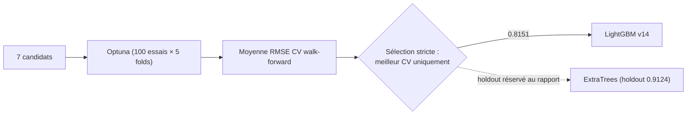
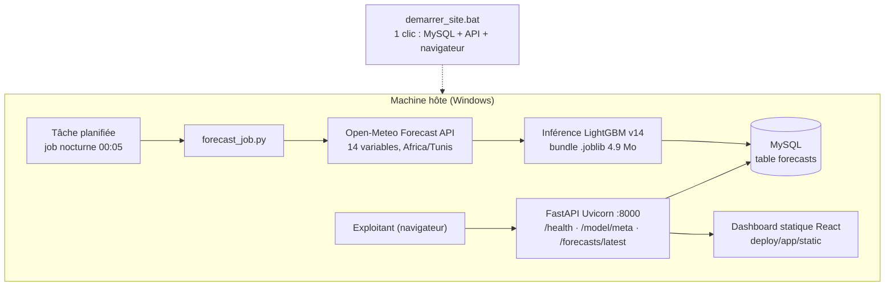

# STEG HelioCast AI — Système intelligent de prévision de la production photovoltaïque

> Stage 2 Mois Data Science — STEG (Société Tunisienne de l'Électricité et du Gaz)

---

## Sommaire

1. [Aperçu du projet](#1-aperçu-du-projet)
2. [Contexte du projet](#2-contexte-du-projet)
3. [Architecture système](#3-architecture-système)
4. [Description des données](#4-description-des-données)
5. [Pipeline de traitement des données](#5-pipeline-de-traitement-des-données)
6. [Feature engineering](#6-feature-engineering)
7. [Modèles de Machine Learning](#7-modèles-de-machine-learning)
8. [Optimisation des hyperparamètres](#8-optimisation-des-hyperparamètres)
9. [Évaluation du modèle](#9-évaluation-du-modèle)
10. [Résultats finaux](#10-résultats-finaux)
11. [Architecture de production](#11-architecture-de-production)
12. [Structure du projet](#12-structure-du-projet)
13. [Guide d'installation](#13-guide-dinstallation)
14. [Guide d'utilisation](#14-guide-dutilisation)
15. [Configuration](#15-configuration)
16. [Reproductibilité](#16-reproductibilité)
17. [Limites et perspectives](#17-limites-et-perspectives)
18. [Auteur et informations](#18-auteur-et-informations)

---

## 1. Aperçu du projet

### Problème métier

STEG exploite des centrales photovoltaïques réparties sur le territoire tunisien. Ces centrales sont **intermittentes** : leur production dépend du rayonnement solaire, des nuages, de la température et de la poussière — des variables que personne ne contrôle. Pour intégrer ces centrales au réseau et optimiser la production nationale, l'exploitant doit **connaître à l'avance** la production attendue, par site et par heure.

Sans prévision, l'énergie solaire est une contrainte subie : réserve tournante mobilisée par sécurité, écarts de production non anticipés, sous-utilisation du réseau. Une prévision fiable transforme cette contrainte en **ressource planifiable**.

### Pourquoi prévoir la production photovoltaïque ?

| Enjeu | Bénéfice de la prévision |
|---|---|
| **Équilibre offre/demande** | Ajuster les centrales thermiques ou les imports à l'avance, avec 24 h à 7 jours de visibilité |
| **Intégration réseau** | Réduire les contraintes de stabilité et les réserves inutiles |
| **Exploitation** | Planifier les maintenances pendant les faibles productions, anticiper les rampes (montée/descente rapide au lever/coucher du soleil) |
| **Marché de l'électricité** | Engager des volumes prévisionnels sur le marché, diminuer les pénalités d'écart |
| **Suivi des actifs** | Définir une référence (attendu vs réel) pour détecter les défauts de centrale (salissure, onduleur, câblage) |

### Objectif du projet

Construire un système de prévision **horaire de la production PV (MW) de J → J+6** (horizon 7 jours, 168 h par site) pour **6 centrales STEG de 10 MW chacune**, intégré dans un outil opérationnel complet :

- pipeline de données et de modélisation **reproductible** (données STEG + météo Open-Meteo) ;
- modèle de Machine Learning sélectionné sur **validation temporelle (walk-forward)** ;
- **job quotidien automatisé** qui régénère les prévisions chaque nuit ;
- **API REST** et **dashboard interactif** pour l'exploitant.

---

## 2. Contexte du projet

### Contexte entreprise

Projet mené dans le cadre d'un **stage Data Science à la STEG**. Les données de production proviennent des centrales STEG (systèmes SCADA, pas de temps 1 minute, agrégés à l'heure), les données météo proviennent du service ouvert **Open-Meteo** (API Forecast et Historical Forecast), et le tout est consolidé dans une base MySQL pour la production.

### Défis de la prévision des énergies renouvelables

1. **Intermittence** — la production est pilotée par le ciel : un passage nuageux de 30 min fait chuter la production de 10 MW à 2 MW.
2. **Non-linéarité** — la production est nulle la nuit et saturée aux heures de fort ensoleillement ; l'erreur est concentrée en journée.
3. **Hétérogénéité des sites** — Tozeur (climat désertique, ciel clair) est facile à prévoir ; Feriana (zone montagneuse, nuages d'après-midi) est difficile.
4. **Qualité des données de terrain** — trous SCADA, valeurs aberrantes, arrêts ponctuels, décalages de fuseau horaire.
5. **Horizon long (7 jours)** — l'erreur de prévision météo croît avec l'horizon ; l'information physique (élévation du soleil, ciel clair) reste fiable.

### Approche Data Science / Machine Learning

Le projet repose sur une approche **déterministe régie par la physique, apprise par gradient boosting** :

- les **coordonnées solaires** (élévation, azimut, irradiance ciel clair) sont calculées par `pvlib` et injectées comme caractéristiques : elles apportent l'information structurante ;
- les **variables météo** (rayonnement, nébulosité, température) apportent la condition atmosphérique du moment ;
- un **modèle LightGBM supervisé** apprend la relation production = f(physique du soleil, météo, calendrier, site) sur **4 ans de données** (2022-07 → 2026-07) ;
- la **sélection finale** se fait uniquement sur **CV walk-forward** (jamais sur le holdout), pour garantir la robustesse temporelle en production.

---

## 3. Architecture système

### Pipeline complet

```mermaid
flowchart LR
    subgraph AMONT["1. Acquisition"]
        A1["SCADA STEG (xlsx, 1 min)"] --> A2["clean_production.py<br/>nettoyage + agrégation horaire"]
        A3["Open-Meteo Historical Forecast<br/>4 ans, 14 variables"] --> A4["download_openmeteo.py<br/>+ contrôles qualité JSON"]
    end

    subgraph MILIEU["2. Préparation"]
        A2 --> M1["merge_weather_production.py<br/>alignement temporel strict"]
        A4 --> M1
        M1 --> M2["Feature engineering<br/>25 features + 6 dummies site"]
        M2 --> M3["Dataset v14<br/>data_hash 485e7a3a…"]
    end

    subgraph AVAL["3. Modélisation"]
        M3 --> T1["HPO Optuna × 7 algorithmes"]
        T1 --> T2["CV walk-forward 5 folds"]
        T2 --> T3["Sélection : LightGBM v14"]
        T3 --> T4["Bundle production .joblib<br/>modèle + meta + coords + capacité"]
    end

    subgraph PROD["4. Production"]
        P1["forecast_job (00:05)"] --> P2["Open-Meteo Forecast<br/>Africa/Tunis"]
        P2 --> P3["Inférence LightGBM<br/>6 sites × 168 h = 1008 points"]
        P3 --> P4["MySQL (table forecasts)"]
        P4 --> P5["FastAPI (127.0.0.1:8000)"]
        P5 --> P6["Dashboard React (2 pages)"]
    end

    T4 -. "bundle" .-> P3
```



Les phases **1–3** sont hors-ligne (entraînement, réalisé une fois), la phase **4** est le système opérationnel quotidien.

---

## 4. Description des données

### 4.1 Production (SCADA STEG)

| Élément | Description |
|---|---|
| Source | Fichier Excel des productions PV STEG |
| Pas de temps brut | 1 minute |
| Pas de temps modélisation | 1 heure (agrégation : somme ou moyenne, selon la variable) |
| Période | 2022-07-13 → 2026-07-12 (≈ 4 ans) |
| Unité | MW (puissance) |

### 4.2 Météo historique (entraînement)

| Élément | Description |
|---|---|
| Source | Open-Meteo **Historical Forecast API** (réanalyse) |
| Variables (14) | `shortwave_radiation`, `direct_normal_irradiance`, `direct_radiation`, `diffuse_radiation`, `temperature_2m`, `wind_speed_10m`, `cloud_cover`, `cloud_cover_low/mid/high`, `relative_humidity_2m`, `visibility`, `precipitation`, `is_day` |
| Fichier | `data/Open-Meteo/Historical_Forecast/Global/weather_all_sites.csv` |
| Contrôles qualité | 1 rapport JSON par site (`Quality/*.json`) : taux de complétude, valeurs manquantes, bornes physiques |

### 4.3 Météo temps réel (production)

| Élément | Description |
|---|---|
| Source | Open-Meteo **Forecast API** — `https://api.open-meteo.com/v1/forecast` |
| Modèle météo | `best_match` (combinaison des modèles disponibles) |
| Variables | Identiques aux 14 variables d'entraînement (cohérence absolue) |
| Fuseau | `Africa/Tunis`, retourné explicitement dans la requête |
| Horizon | 7 jours, pas horaire |

### 4.4 Centrales

| Site | Latitude | Longitude | Capacité | Montage | Ombrier | Données depuis |
|---|---|---|---|---|---|---|
| `tozeur_1` — Tozeur 1 | 33.9086 | 8.0463 | 10 MW | Fixe | Non | 2022-07-13 |
| `tozeur_2` — Tozeur 2 | 33.9086 | 8.0463 | 10 MW | Fixe | Non | 2022-07-13 |
| `meknassi_eppm` — Meknassi (EPPM) | 34.6054 | 9.6022 | 10 MW | Fixe | Non | 2023-08-07 |
| `elmourabitine_eni` — Elmourabitine (ENI) | 33.0502 | 10.4633 | 10 MW | **Tracker 1 axe** | Oui | 2022-12-30 |
| `feriana_csfb` — Feriana CSFB | 34.8891 | 8.5530 | 10 MW | Fixe | Non | 2025-04-22 |
| `feriana_csfc` — Feriana CSFC | 34.8892 | 8.5534 | 10 MW | Fixe | Non | 2025-04-22 |

**Total : 60 MW installés** répartis sur Tozeur (désertique), Meknassi (centre), Elmourabitine (sud-est, montage suiveur) et Feriana (nord-ouest, montagneux).

### 4.5 Fréquence et fuseau horaire

- **Fréquence : 1 heure** (production et météo alignées heure par heure, 24 points/jour).
- **Fuseau : `Africa/Tunis`** (UTC+1, heure légale toute l'année). Toutes les séries sont exprimées en heure locale — une étude dédiée (`scripts/Hypothese/verify_timezone_alignment.py`) a confirmé l'alignement production/météo et écarté l'ancien décalage de +1 h de la v13 (voir §16).
- **Politique v14** : les timestamps ne sont jamais décalés ; `Africa/Tunis` ne sert qu'aux calculs solaires `pvlib`.

### 4.6 Synthèse

| Lot | Période | Points |
|---|---|---|
| Entraînement + CV | 2022-07-13 → 2025-06-30 | ~260 000 h |
| **Holdout (test strict)** | 2025-07-01 → 2026-07-12 | **51 300 h** |

---

## 5. Pipeline de traitement des données

### 5.1 Nettoyage de la production SCADA (`scripts/clean_production.py`)

1. Lecture du fichier Excel, suppression des colonnes parasites, normalisation des identifiants de sites.
2. **Agrégation minute → horaire** (somme par heure pour la production).
3. **Bornage physique** : production dans `[0, capacité]` ; valeurs négatives ou > capacité écartées.
4. **Imputation** : heures manquantes interpolées linéairement sur des fenêtres courtes ≤ 3 h ; au-delà, marquées manquantes puis **exclues** de l'entraînement (pas de remplissage abusif).
5. **Arrêts SCADA** : longues périodes plates à 0 (centrale hors service) détectées et exclues, pour ne pas apprendre des « faux zéros ».

### 5.2 Téléchargement météo (`scripts/download_openmeteo.py`)

- Requête Open-Meteo Historical Forecast par site, 14 variables horaires, fuseau explicite.
- **Contrôles qualité par site** (récapitulés dans `data/Open-Meteo/Historical_Forecast/Quality/`) : complétude de la série, détection de valeurs manquantes et hors bornes (ex. `shortwave_radiation` hors `[0, 1400]` W/m²).

### 5.3 Fusion météo + production (`scripts/merge_weather_production.py`)

1. **Alignement strict** sur l'index horaire des timestamps (jointure à l'heure exacte, fuseau unique `Africa/Tunis`).
2. Suppression des lignes orphelines de part et d'autre (production sans météo et inversement).
3. Fenêtre finale : 2022-07-13 00:00 → 2026-07-12 00:00 (4 ans) — les sites récents (Feriana, 2025-04) contribuent naturellement moins de lignes.
4. Un **hash des données** (`compute_data_hash`) est calculé : toute modification du pipeline produit un nouveau hash → les caches d'optimisation sont invalidés automatiquement.

### 5.4 Pondération et équilibre

- Les heures de nuit (production = 0) sont conservées : elles apprennent au modèle la contrainte physique jour/nuit, sans biaiser la perte (0 prédit exactement ≈ 0).
- Le holdout est **chronologique pur** : aucune ligne du test n'est vue pendant l'entraînement et la CV.

---

## 6. Feature engineering

### 6.1 Description des 31 caractéristiques

Le pipeline v14 utilise **25 caractéristiques techniques + 6 dummies de site** (encodage one-hot).

| Famille | Caractéristiques | Pourquoi c'est utile |
|---|---|---|
| **Météo** (12) | `shortwave_radiation`, `direct_normal_irradiance`, `direct_radiation`, `diffuse_radiation`, `temperature_2m`, `wind_speed_10m`, `cloud_cover`, `cloud_cover_low`, `cloud_cover_mid`, `cloud_cover_high`, `relative_humidity_2m`, `visibility`, `precipitation` | L'irradiance est le **moteur physique** de la production ; nébulosité/visibilité/précipitation décrivent les passages nuageux ; température module le rendement (−0.79 %/°C mesuré) |
| **Calendrier** (6) | `hour`, `day_of_week`, `hour_sin`, `hour_cos`, `doy_sin`, `doy_cos` | Saisonnalités horaire (cycle journalier) et annuelle (déclinaison du soleil, été/hiver), encodées cycliquement pour rester continues en fin de période |
| **Jour/nuit** (1) | `is_day` | Régime binaire fondamental : production nulle la nuit, contrainte apprise et appliquée explicitement en inférence |
| **Géométrie solaire** (3) | `solar_elevation`, `solar_azimuth`, `clearsky_dni` | Calculées par `pvlib` : position du soleil et irradiance ciel clair — **#1 du SHAP** (`clearsky_dni`, ~28 % de l'importance) |
| **Physique PV** (3) | `clearsky_index`, `cell_temp_proxy`, `cloud_cover_x_ghi` | Rapport observé/ciel clair (conditions atmosphériques), température de cellule approchée (effet thermique résiduel), interaction nébulosité × rayonnement |
| **Site** (6 dummies) | `site_tozeur_1`, `site_tozeur_2`, `site_meknassi_eppm`, `site_elmourabitine_eni`, `site_feriana_csfb`, `site_feriana_csfc` | Encodent les effets fixes par site (topographie, orientation, tracker d'Elmourabitine) |

### 6.2 Pourquoi ces familles couvrent tout le problème

| Dimension | Caractéristiques qui la portent |
|---|---|
| **Quand ?** | Calendrier cyclique + `is_day` + géométrie solaire |
| **Quel ciel ?** | Météo (14 variables) + `clearsky_index` + `cloud_cover_x_ghi` |
| **Quel site ?** | Dummies site + température + coordonnées dans la géométrie |
| **Combien ?** | Interaction rayonnement × nébulosité, capacité absorbée par le modèle |

> En SHAP (holdout, 3 000 échantillons) : `clearsky_dni` (28.5 %), `solar_elevation` (43.7 % cumulé), `shortwave_radiation` (56.8 %), `direct_normal_irradiance` (67.6 %), `diffuse_radiation` (70.8 %) — la **physique solaire domine**, la température n'arrive qu'en 7ᵉ position : comportement attendu pour des arbres.

---

## 7. Modèles de Machine Learning

### 7.1 Candidats évalués (budget commun, mêmes données/splits)

| Modèle | Famille | Scout |
|---|---|---|
| **LightGBM** ✅ déployé | Gradient boosting (histogrammes) | Rapide, robuste sur 31 features hétérogènes |
| XGBoost | Gradient boosting (pre-sorted) | Référence industrielle |
| CatBoost | Gradient boosting (catégories natives) | Correct, plus lent ici |
| HistGradientBoosting (scikit-learn) | Gradient boosting histogrammes | Bon équilibre |
| Random Forest | Bagging d'arbres | Basse variance |
| Extra Trees | Bagging extrême (splits aléatoires) | Meilleur holdout du banc |
| MLP (réseau de neurones) | Perceptron multicouche (StandardScaler + MLP) | Test non-linéaire profond |

### 7.2 Stratégie de sélection du modèle



**Règle décisive** : le champion est choisi sur la **CV walk-forward uniquement** ; le holdout n'est **jamais** utilisé pour choisir (anti-overfitting du test). C'est pourquoi **LightGBM v14 (CV 0.8151)** est déployé même si ExtraTrees bat tout au holdout (0.9124) : la politique est assumée, documentée et reproductible (`selection_policy` dans le bundle).

---

## 8. Optimisation des hyperparamètres

| Élément | Réglage |
|---|---|
| Outil | **Optuna** (TPE sampler, pruning) |
| Cible | RMSE, minimisé |
| Scheme d'évaluation | **Walk-forward : 5 folds chronologiques** (année 1→4 pour entraîner, 5ᵉ pour valider, décalage glissant de 3 mois) |
| Budget | 100 essais/modèle ≈ **15 min** pour les 7 modèles |
| Graines | `random_state = 42` partout |
| Résultats | `models_final_14/hpo_*.json` (meilleurs paramètres) + `optuna_*.db` (historique complet) |

**Pourquoi le walk-forward ?** Une CV aléatoire (K-Fold) mélange les jours et « voit » l'avenir : les métriques deviennent optimistes et trompeuses en production. Le walk-forward rejoue exactement le scénario réel (prédire le futur sans le connaître) — c'est le seul schéma honnête pour une série temporelle.

**Hyperparamètres retenus (LightGBM v14)** : `n_estimators=1000`, `num_leaves=145`, `max_depth=7`, `learning_rate=0.0391`, seed 42. Modèle sans scaler (arbres) → déploiement simple et stable.

---

## 9. Évaluation du modèle

### 9.1 Définitions des métriques

Soient `y_i` la production réelle (MW), `ŷ_i` la prédiction, `n` le nombre d'échantillons et `C = 10 MW` la capacité unitaire :

| Métrique | Formule | Signification pratique |
|---|---|---|
| **RMSE** | √(Σ(ŷᵢ − yᵢ)² / n) | Erreur quadratique moyenne : pénalise fortement les gros écarts (nuages soudains), unité MW |
| **MAE** | Σ\|ŷᵢ − yᵢ\| / n | Erreur absolue moyenne : écart typique, sans surpondération des extrêmes, unité MW |
| **R²** | 1 − Σ(ŷᵢ − yᵢ)² / Σ(yᵢ − ȳ)² | Proportion de variance expliquée : 1 = parfait, 0 = bête moyenne |
| **nMAE** | MAE × 100 / C | MAE **normalisé par la capacité** : comparable entre centrales de tailles différentes |
| **nRMSE** | RMSE × 100 / C | RMSE normalisé par la capacité |
| **MAPE diurne** | moyenne sur heures à production > 0.5 MW de \|ŷᵢ − yᵢ\| / yᵢ | Erreur relative en % sur les heures de production effective (exclut les 0 la nuit qui fausseraient le MAPE classique) |

### 9.2 Cadre d'évaluation

- **Entraînement + CV** : 2022-07-13 → 2025-06-30 (5 folds walk-forward).
- **Holdout (test)** : 2025-07-01 → 2026-07-12, **51 300 heures** jamais vues.
- Rapports systématiques : `reports/v14_holdout_comparison.csv`, `v14_fold_metrics.csv`, `v14_errors_by_site.csv`, `v14_errors_hourly.csv`, `v14_errors_monthly.csv`, `v14_errors_day_night.csv`.

---

## 10. Résultats finaux

### 10.1 Performance globale (holdout strict, modèle déployé)

| Métrique | Modèle v14 | Persistance 24 h | Gain |
|---|---|---|---|
| **MAE** | **0.527 MW** | 0.615 MW | **−14.3 %** |
| **RMSE** | **1.080 MW** | 1.472 MW | **−26.7 %** |
| **R²** | **0.864** | 0.747 | **+0.117** |
| **nMAE** | **5.27 %** | 6.15 % | −0.88 pt |
| **nRMSE** | **10.80 %** | 14.72 % | −3.92 pts |
| MAPE diurne | **33.1 %** | 45.9 % | −12.8 pts |

Persistance 24 h = « même heure que la veille », référence naïve d'un exploitant sans modèle.

### 10.2 Comparaison des 7 modèles (holdout, 51 300 h)

| Modèle | MAE | RMSE | R² | MAPE diurne % | nMAE % | nRMSE % | Train (s) |
|---|---|---|---|---|---|---|---|
| **extratrees** | **0.4185** | **0.9124** | **0.9027** | **31.85** | **4.19** | **9.12** | 16.2 |
| histgb | 0.4584 | 0.9177 | 0.9016 | 32.37 | 4.58 | 9.18 | 1.4 |
| mlp | 0.4556 | 0.9714 | 0.8898 | 32.73 | 4.56 | 9.71 | 20.8 |
| randomforest | 0.4861 | 1.0001 | 0.8831 | 33.57 | 4.86 | 10.00 | 6.5 |
| catboost | 0.5094 | 1.0412 | 0.8733 | 32.35 | 5.09 | 10.41 | 63.9 |
| xgboost | 0.5211 | 1.0770 | 0.8645 | 32.72 | 5.21 | 10.77 | 18.7 |
| **lightgbm (déployé)** | 0.5269 | 1.0798 | 0.8638 | 33.13 | 5.27 | 10.80 | **1.2** |

> Rappel : le déploiement de **LightGBM** est fondé sur la **CV walk-forward (0.8151, la meilleure des 7)** — pas sur ce tableau holdout (voir §7.2).

### 10.3 CV walk-forward (LightGBM, 5 folds)

| Fold | Fenêtre | RMSE |
|---|---|---|
| 1 | 2024-01 → 2024-04 | 0.9727 |
| 2 | 2024-04 → 2024-07 | 0.8583 |
| 3 | 2024-07 → 2024-10 | 0.7039 |
| 4 | 2024-10 → 2025-01 | 0.7643 |
| 5 | 2025-01 → 2025-04 | 0.7762 |
| **Moyenne** | | **0.8151** |

Hiver et passages nuageux plus durs (fold 1) ; été 2024 le plus facile (ciel stable).

### 10.4 Performance par site (holdout)

| Site | MAE | RMSE | R² | MAPE diurne % | nMAE % | nRMSE % | n |
|---|---|---|---|---|---|---|---|
| tozeur_2 | **0.281** | **0.673** | **0.943** | 20.44 | 2.81 | 6.73 | 8 543 |
| tozeur_1 | 0.292 | 0.679 | 0.943 | **20.49** | 2.92 | 6.79 | 8 531 |
| meknassi_eppm | 0.344 | 0.764 | 0.900 | 34.66 | 3.44 | 7.64 | 8 482 |
| elmourabitine_eni | 0.427 | 0.839 | 0.891 | 31.79 | 4.27 | 8.39 | 8 587 |
| feriana_csfb | 0.581 | 1.168 | 0.881 | 40.81 | 5.81 | 11.68 | 8 575 |
| feriana_csfc | 0.583 | 1.194 | 0.872 | 42.07 | 5.83 | 11.94 | 8 582 |

**Lecture** : Tozeur (ciel désertique clair) ~2.9 % d'erreur normalisée ; Feriana (montagne, nuages d'après-midi) ~5.8 % — un effet **géographique**, pas un défaut du modèle.

### 10.5 Régime jour / nuit (holdout)

| Régime | MAE | RMSE | R² | n |
|---|---|---|---|---|
| Nuit | ≤ 0.00001 MW | ≤ 0.0004 MW | — | 25 396 |
| Jour (`is_day=1`) | 0.829 | 1.284 | 0.787 | 25 904 |
| Jour actif (> 0.5 MW) | 0.902 | 1.341 | 0.703 | 22 678 |

**Nuance clé** : la nuit est quasi parfaite (0 MW, contrainte physique appliquée). Toute l'erreur se concentre en journée — le RMSE nocturne serait artificiellement flatteur sans cette séparation.

### 10.6 Profil horaire de l'erreur

| Heure | MAE | RMSE | R² |
|---|---|---|---|
| 0–5 h | 0.000 | 0.000 | — |
| 6 h | 0.046 | 0.109 | 0.883 |
| 7 h | 0.286 | 0.563 | 0.882 |
| 8 h | 0.731 | 1.100 | 0.775 |
| 9 h | 0.984 | 1.387 | 0.594 |
| **15 h** | **1.120** | **1.616** | 0.448 |
| **16 h** | 1.136 | 1.526 | 0.547 |
| 18 h | 0.308 | 0.641 | 0.758 |
| 20–23 h | 0.000 | 0.000 | — |

L'erreur maximale se situe à **15–16 h** : convection et nuages d'après-midi en Tunisie — limite de la prévision météo, pas du modèle.

### 10.7 Validation physique (tests de sensibilité)

Test déterministe (`Test_impact_temperature/`) — Tozeur 1, GHI fixe à 950 W/m² :

| Température | 10 °C | 20 °C | 30 °C | 40 °C | 50 °C |
|---|---|---|---|---|---|
| Production prédite (MW) | 8.29 | 7.99 | 7.66 | 7.34 | 6.95 |
| Variation | — | −3.6 % | −7.6 % | −11.5 % | −16.2 % |

→ **T ↑ ⇒ Production ↓ (−0.79 %/°C)** et **GHI ↑ ⇒ Production ↑** : le modèle respecte la physique PV (forte assurance qualité pour l'exploitant).

---

## 11. Architecture de production

### 11.1 Vue déployée



### 11.2 Brique par brique

| Brique | Technologie | Rôle |
|---|---|---|
| **Job batch** | Python (pandas + LightGBM), 1 exécution/jour | Récupère la météo 7 jours, prédit 1008 points (6 sites × 168 h), écrit en MySQL (~3 s) |
| **Base** | **MySQL 8** (XAMPP), table `forecasts` | Historique des vagues de prévision, upsert par clé `(site_id, timestamp, generated_at)` |
| **API** | **FastAPI + Uvicorn** (port 8000) | Sert le dernier lot + métadonnées du modèle + l'état de santé (ping MySQL) |
| **Dashboard** | **React + Vite + Tailwind + Recharts**, build statique dans `deploy/app/static/` | 2 pages : *Vue d'ensemble* et *Prévisions* (sélecteur centrale/date, profils horaires, agrégats MWh, % capacité) |
| **Scheduler** | Windows Task Scheduler (`deploy/schedule_windows.ps1`) ou `crontab` | Relance automatique à 00:05 |
| **Conteneurs (option)** | `deploy/Dockerfile` + `docker-compose.yml` | API + MySQL packagés (déploiement serveur propre) |
| **Lanceur** | `demarrer_site.bat` | Démarrage 1 clic : MySQL si absent → API → navigateur |

### 11.3 API publique

| Endpoint | Réponse |
|---|---|
| `GET /health` | `{"status":"ok","model_version":"v14","model":"lightgbm","database":"ok","sites":6}` |
| `GET /model/meta` | Métadonnées du bundle : capacité, features, métriques holdout, data_hash |
| `GET /forecasts/latest` | Dernier lot : `generated_at`, 7 jours, 6 sites, 1008 points `{site_id, timestamp, prediction_mw}` |

### 11.4 Schéma de base

```sql
CREATE TABLE forecasts (
    id            BIGINT AUTO_INCREMENT PRIMARY KEY,
    timestamp     DATETIME NOT NULL,      -- heure locale Africa/Tunis
    site_id       VARCHAR(64) NOT NULL,
    prediction_mw DECIMAL(10,4) NOT NULL,
    generated_at  DATETIME NOT NULL,      -- instant de génération (heure locale)
    UNIQUE KEY uq_site_ts_gen (site_id, timestamp, generated_at)
) ENGINE=InnoDB DEFAULT CHARSET=utf8mb4;
```

Le dashboard lit toujours `MAX(generated_at)` → il affiche la vague la plus récente.

---

## 12. Structure du projet

```
project/
├── config/                        # Paramétrage des centrales (sites.yaml)
├── data/                          # Données brutes et préparées (non versionnées : locales)
│   ├── PV Production Data/        #   → Excel SCADA STEG
│   ├── Open-Meteo/                #   → météo historique + rapports qualité
│   ├── production_cleaned/        #   → production nettoyée (minute + horaire)
│   ├── merged/                    #   → fusion horaire météo + production
│   └── final_data/                #   → datasets de modélisation
├── deploy/                        # Système de production
│   ├── app/
│   │   ├── api.py                 #   → FastAPI (3 endpoints)
│   │   ├── db.py                  #   → accès MySQL (schéma, upsert, lecture)
│   │   ├── config.py              #   → configuration .env
│   │   ├── forecast_job.py        #   → job quotidien (météo → modèle → MySQL)
│   │   └── static/                #   → build du dashboard (servi par l'API)
│   ├── requirements.txt           #   → dépendances d'inférence/déploiement
│   ├── Dockerfile                 #   → image API
│   ├── docker-compose.yml         #   → API + MySQL conteneurisés
│   ├── schedule_windows.ps1       #   → création de la tâche planifiée Windows
│   └── crontab                    #   → équivalent Linux
├── dashboard/                     # Code source du dashboard (React/Vite/Tailwind)
│   └── src/
│       ├── pages/                 #   → OverviewPage, ForecastPage
│       ├── components/            #   → Layout, StatCard, charts, WeatherIcon…
│       ├── api/ hooks/ utils/     #   → client API, hooks, maths de prévision, formats
├── modeling/                      # Notebooks + interface d'inférence
│   ├── Model/....ipynb            #   → notebooks de modélisation (v1…v14)
│   ├── inference.py               #   → API d'inférence v14 (used end-to-end)
│   └── inference_modelv13.py      #   → variante v13
├── models_final_14/               # Livrable modèle v14
│   ├── final_model_bundle.joblib  #   → bundle déployé (modèle + meta + coords)
│   ├── hpo_*.json                 #   → meilleurs hyperparamètres Optuna
│   ├── optuna_*.db                #   → historiques d'optimisation
│   ├── METRICS_V14.md             #   → rapport de métriques complet
│   └── COMPARISON_VERSIONS.md     #   → comparaison v13/v14 (non-comparabilité)
├── scripts/                       # Pipeline Data Science (ordres chronologiques)
│   ├── download_openmeteo.py      #   → acquisition météo historique
│   ├── clean_production.py        #   → nettoyage SCADA
│   ├── merge_weather_production.py#   → fusion alignée
│   ├── eda.py                     #   → analyses exploratoires (figures/eda/)
│   ├── modeling.py                #   → pipeline de modélisation (HPO + sélection)
│   └── modeling_v14.py            #   → pipeline v14 (production du bundle)
├── figures/                       # Graphiques EDA + SHAP
├── reports/                       # Rapports CSV systématiques v14
├── Test_impact_temperature/       # Validation physique (sensibilité T et GHI)
├── ERA5 historical weather/       # Script ERA5 (placeholder : clé CDS requise)
├── demarrer_site.bat              # Démarrage 1 clic (MySQL + API + navigateur)
└── README.md                      # Ce document
```

---

## 13. Guide d'installation

### 13.1 Prérequis

| Composant | Version testée | Rôle |
|---|---|---|
| Python | 3.10+ (3.14 en développement) | Job + API + modélisation |
| MySQL | 8.x (XAMPP) | Stockage des prévisions |
| Node.js + npm | 20+ | Build du dashboard |
| Navigateur | Chrome/Edge/Firefox | Visualisation |

### 13.2 Environnement Python

```bash
# depuis la racine du projet
python -m venv .venv
# Windows : .venv\Scripts\activate    |  Linux/macOS : source .venv/bin/activate
pip install -r deploy/requirements.txt
```

### 13.3 MySQL

1. Installer/démarrer XAMPP (ou un MySQL 8 autonome) sur le port 3306.
2. Créer la base et l'utilisateur (via phpMyAdmin ou CLI) :

```sql
CREATE DATABASE IF NOT EXISTS heliocast CHARACTER SET utf8mb4;
CREATE USER IF NOT EXISTS 'heliocast'@'localhost' IDENTIFIED BY 'changer_moi';
GRANT ALL PRIVILEGES ON heliocast.* TO 'heliocast'@'localhost';
FLUSH PRIVILEGES;
```

3. La table `forecasts` est créée automatiquement au premier lancement du job.

### 13.4 Dashboard (développement)

```bash
cd dashboard
npm install
npm run dev        # dev serveur Vite (port 5173, proxying /api → :8000)
```

Build de production (recopié vers `deploy/app/static/`) :

```bash
npm run build
```

### 13.5 Configuration

Copier `deploy/.env.example` → `deploy/.env` et ajuster les variables (§15). Les valeurs par défaut correspondent à l'installation locale standard (aucune modification nécessaire).

---

## 14. Guide d'utilisation

### 14.1 Démarrage 1 clic (recommandé)

```bash
./demarrer_site.bat
```

Détecte MySQL et l'API, démarre ce qui manque, puis ouvre http://127.0.0.1:8000/ dans le navigateur.

### 14.2 Commandes principales

| Action | Commande (racine du projet) |
|---|---|
| Générer + stocker les prévisions | `python -m deploy.app.forecast_job` |
| Lancer l'API | `cd deploy && python -m uvicorn app.api:app --host 127.0.0.1 --port 8000` |
| Ouvrir le dashboard | http://127.0.0.1:8000/ |
| État du service | `curl http://127.0.0.1:8000/health` |
| Ingestion météo historique | `python scripts/download_openmeteo.py` |
| Nettoyage SCADA | `python scripts/clean_production.py` |
| Fusion météo + production | `python scripts/merge_weather_production.py` |
| Analyse exploratoire | `python scripts/eda.py` |
| Entraînement + HPO (recrée le bundle) | `python scripts/modeling_v14.py` |
| Planifier le job nocturne (Windows) | `powershell -ExecutionPolicy Bypass -File deploy/schedule_windows.ps1` |

> Le job journalier est **idempotent** et rapide (~3 s pour 1008 points) : aucune peur à le relancer manuellement.

---

## 15. Configuration

### 15.1 Variables d'environnement (`deploy/.env`)

| Variable | Défaut | Rôle |
|---|---|---|
| `DB_HOST` | `127.0.0.1` | Hôte MySQL |
| `DB_PORT` | `3306` | Port MySQL |
| `DB_NAME` | `heliocast` | Base de données |
| `DB_USER` | `heliocast` | Utilisateur MySQL |
| `DB_PASSWORD` | `changer_moi` | Mot de passe (à changer hors dév.) |
| `BUNDLE_PATH` | `models_final_14/final_model_bundle.joblib` | Bundle du modèle |
| `FORECAST_DAYS` | `7` | Horizon du job (jours) |
| `MODEL_VERSION` | `v14` | Version affichée par l'API |
| `API_PORT` | `8000` | Port HTTP |

### 15.2 Fichier `config/sites.yaml`

Déclaration des 6 centrales : `id`, nom, coordonnées (lat/lon), fuseau (`Africa/Tunis`), capacité installée (`10.0` MW), type de montage (fixe / tracker), période de données. Utilisé par le pipeline d'entraînement (géométrie solaire) et l'inférence (capacité de clipping).

---

## 16. Reproductibilité

| Pilier | Dispositif |
|---|---|
| **Graines aléatoires** | `random_state=42` (Optuna, modèles, splits) — résultats rejouables |
| **Signature des données** | `data_hash = 485e7a3ad340d571c4117f575012cc5f` embarqué dans le bundle ; tout changement de données invalide les caches HPO |
| **Bundle auto-suffisant** | `final_model_bundle.joblib` contient : modèle, 31 features, coordonnées, capacité par site, fuseau, métriques CV/holdout, ligne de base persistance, politique de sélection, plage d'entraînement |
| **Version contrôle** | Git (racine du projet), commit « STEG HelioCast AI v14 » ; les gros artefacts (données brutes, bases Optuna) restent locaux |
| **Correction v13 → v14** | vérification du décalage de fuseau +1 h (l'ancien bundle n'est plus déployable — voir `COMPARISON_VERSIONS.md`) |
| **Rapports** | 6 fichiers CSV systématiques + `METRICS_V14.md` générés avec le bundle |

**Non encore industrialisé** : versioning de données (DVC), suivi d'expériences (MLflow) — prévus en perspectives (§17).

---

## 17. Limites et perspectives

### Limites connues

| Limite | Impact | Origine |
|---|---|---|
| Source météo unique (`best_match` Open-Meteo) | Nuages mal positionnés → MAPE diurne ±33 % | Un seul modèle météo, pas d'ensemble |
| Erreur maximale 15–16 h | MAE ~1.1 MW en pointe d'après-midi | Convection estivale tunisienne |
| Sites montagneux (Feriana) | nRMSE ~12 % vs ~7 % à Tozeur | Topographie, ciel local très variable |
| Horizon 7 jours | l'erreur croît avec l'horizon | Erreur des prévisions météo longues |
| Météo ERA5 non intégrée | réanalyse expérimentale indisponible | Absence de clé CDS (service copernicus) — script placeholder |
| Modèle statique | pas de ré-entraînement ni monitoring de dérive en ligne | Pipeline batch manuel |
| Batch quotidien | pas de prévision infra-horaire ni de mise à jour en temps réel | Cadence SCADA jour |

### Perspectives

1. **Multi-sources météo** : ensemble Open-Meteo + GFS/ICON + quantiles d'incertitude (prévision probabiliste).
2. **Deep learning temporel** : LSTM/Transformer sur séries (au-delà du MLP testé), encodage séquence → contexte nuageux.
3. **Prévision infra-horaire** (15 min) et **ré-émission intra-jour** (nouvelle prévision chaque heure), montée en charge SCADA.
4. **Paramètres PV réels** : orientation/tilt par site, désratage, salissure (soiling), pertes onduleur — au lieu de la capacité nominale.
5. **Détection d'écart** : comparaison prévu/réel pour le monitoring des actifs (alarme défaut de centrale).
6. **MLOps avancé** : DVC (versioning des données), MLflow (tracking), retraining périodique + monitoring du drift, CI/CD.
7. **Déploiement serveur** : Docker Compose validé (Dockerfile fourni), exposition API sécurisée (auth), HTTPS, multi-utilisateurs.

---

## 18. Auteur et informations

| Champ | Valeur |
|---|---|
| **Projet** | STEG HelioCast AI — Système intelligent de prévision de la production photovoltaïque |
| **Modèle de production** | LightGBM v14 (bundle `models_final_14/final_model_bundle.joblib`, data_hash `485e7a3a…`) |
| **Stack** | Python · pandas · scikit-learn · LightGBM · Optuna · pvlib · FastAPI · MySQL · React/Vite |
| **Auteur** | Mohamed Ali Jabri — stage Data Science / Ingénierie, STEG |
| **Contact** | moh.ali.jabri@gmail.com |
| **Version** | v14 — 16 août 2026 |

---

*Document généré pour le projet de Master Data Science et la présentation industrielle STEG. Toutes les métriques proviennent du holdout strict v14 (51 300 h) et des artefacts de production (`reports/`, `models_final_14/METRICS_V14.md`).*